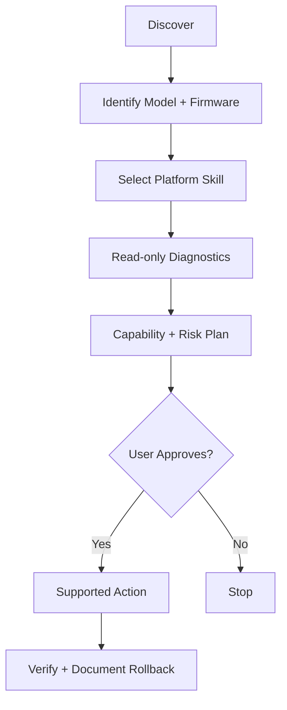

<div align="center">

# HUTJ
### Hazim Universal TV Jailbreak

**AI-guided smart TV discovery, development, customization & compatibility intelligence.**

  

[Features](#features) · [AI Skills](#ai-skills) · [Getting Started](#getting-started) · [Roadmap](#roadmap)

</div>

## Overview

HUTJ is a modular, AI-first project for smart TV engineering. Its mission is to simplify **device identification, official developer tooling, app management, launcher customization, diagnostics and evidence-based root/jailbreak compatibility checks** across multiple TV ecosystems.

> **Project status:** v1.0 is a **documentation and AI-skills pack**. It is not yet a working universal jailbreak, desktop application, or automated device-control engine. Device adapters and runtime execution are planned.

## Features

- **Device Discovery** — identify devices on an authorized network and inspect capabilities.
- **Firmware Intelligence** — version-specific compatibility and risk analysis.
- **AI-Guided Workflows** — platform-specific instructions with approvals and verification.
- **Home Composer** — plan customized TV home experiences, distinguishing launchers from apps.
- **App Management** — official installation and inventory methods where supported.
- **Safety & Recovery** — dry-run plans, audit logs and rollback assessment.

## AI Skills

| Platform-specific (8) | Shared (7) |
|---|---|
| [LG webOS](skills/lg-webos/SKILL.md) | [device-discovery](skills/device-discovery/SKILL.md) |
| [Samsung Tizen](skills/samsung-tizen/SKILL.md) | [firmware-analyzer](skills/firmware-analyzer/SKILL.md) |
| [Android TV](skills/android-tv/SKILL.md) | [root-jailbreak-checker](skills/root-jailbreak-checker/SKILL.md) |
| [Google TV](skills/google-tv/SKILL.md) | [home-composer](skills/home-composer/SKILL.md) |
| [Amazon Fire TV](skills/amazon-fire-tv/SKILL.md) | [app-manager](skills/app-manager/SKILL.md) |
| [Apple tvOS](skills/apple-tvos/SKILL.md) | [backup-recovery](skills/backup-recovery/SKILL.md) |
| [Roku TV](skills/roku-tv/SKILL.md) | [network-adblock](skills/network-adblock/SKILL.md) |
| [Hisense VIDAA](skills/vidaa-tv/SKILL.md) |  |

Skills live under `skills/<name>/SKILL.md`. `registry.json` is the machine-readable index, while `AGENTS.md` governs safe agent behavior.

## Architecture



## Getting Started

```bash
git clone https://github.com/hazim5-stack/HUTJ.git
cd HUTJ
```

Open the repository in your AI coding agent, read `AGENTS.md` and `registry.json`, then select the skill matching your TV. Example prompt:

> Inspect my LG webOS TV using the HUTJ LG skill. Start read-only, verify model and firmware, and ask before any changes.

## Roadmap

| Milestone | Scope | Status |
|---|---|---|
| v1.0 | 15 AI skills, registry and agent policies | Documentation pack |
| v1.1 | Skill validation, schemas and compatibility tests | Planned |
| v1.2 | Local discovery and official protocol adapters | Planned |
| v1.3 | Verified installation, diagnostics and recovery | Planned |
| v2.0 | Desktop UI and AI Home Composer | Planned |

Read [the full roadmap](docs/ROADMAP.md).

## Safety & Responsible Use

Use HUTJ only with TVs you own or have permission to manage. **Developer Mode ≠ root ≠ jailbreak.** Exact model, firmware, region and vendor policies determine what is possible. Never share secrets with agents, assume rollback is guaranteed, or change device state without informed approval.

## Related Open-Source Projects

HUTJ can learn from [CleanYourTV](https://github.com/Gathin23/cleanyourtv), [Free My TV](https://github.com/simbasjungles/free-my-tv), and [TizenBrew Installer](https://github.com/reisxd/TizenBrewInstaller). These are independent projects, **not bundled dependencies**; review their current licenses before integrating code.

## Contributing

Contributions and verified device compatibility reports are welcome. Include model, firmware, reproducible steps, impact and rollback. Never commit credentials or pairing keys.

## Licensing

No project license has been selected yet; **all rights reserved by default** until the owner publishes one. Third-party projects retain their own licenses.

---

<div align="center">Built by **Hazim Batwa** · Independent smart TV engineering initiative</div>
